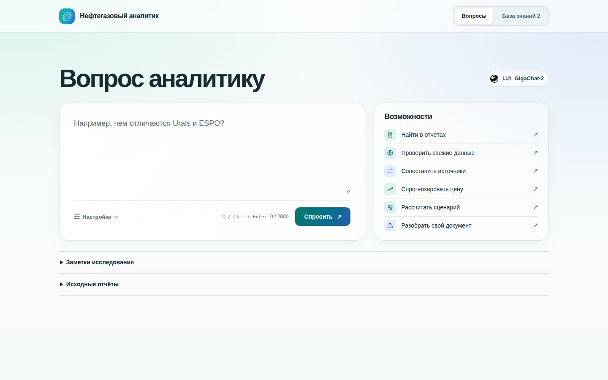

# AI-агент «Нефтегазовый аналитик»

Агент для работы с отраслевыми отчётами, свежими публикациями и расчётом цен нефти. Разработан на **LangGraph и Ouroboros**: модель выбирает следующий инструмент по результатам предыдущего шага. Для каждого вопроса выбирает подходящий источник: загруженные документы, веб-публикации или их сочетание. Актуальные события можно искать сразу в интернете; ограничение «только база знаний» соблюдается всегда. Прогноз Brent/WTI рассчитывается отдельным инструментом, Urals — как сценарий с заданным дисконтом.

**Стек:** Python 3.12, uv, FastAPI, LangGraph, Ouroboros, FAISS, ONNX-эмбеддеры и Langfuse.

**Третья версия:** `review/v3-knowledge-gigachat-20261114`. Добавлены облачный адаптер GigaChat, управляемая база знаний с OCR, точные цитаты, Tavily Extract, instruction skills и заметки через Ouroboros. `main` и вторая ветка сохраняются. Качество живых ответов GigaChat ещё требует проверки с личным ключом.

[Архитектура v3](docs/V3_Architecture.md) · [База знаний](docs/KnowledgeBase.md) · [Результат и следующие шаги](docs/V3_Roadmap.md) · [Подключение GigaChat](docs/GigaChat.md)

## Что умеет стенд

- **Вопросы.** Возможности агента видны рядом с полем ввода. Выберите задачу, отредактируйте предложенный вопрос и отправьте его.
- **База знаний:** загрузка PDF, сканов, изображений, DOCX, XLSX и CSV; версии, просмотр извлечённого текста, первоисточники и архив.
- **Проверка ответа.** Можно раскрыть цитату, посмотреть аргументы вызванного инструмента и сверить прогноз с таблицей по месяцам.
- **Память прогноза.** Сорт, горизонт и сценарные параметры сохраняются между уточнениями. До расчёта можно исправить уже названное значение.
- **Исследовательские заметки:** явное сохранение и продолжение; заметки не считаются проверенными источниками.

Веб-поиск и чтение найденных страниц выбирает модель с соблюдением ограничений пользователя. Численный прогноз рассчитывается отдельно. Проверка обновлений двух исходных PDF сравнивает файл по прежнему URL; новые выпуски по другим ссылкам не обнаруживаются автоматически.



Прежний пользовательский интерфейс сохранён в [архиве](archive/user-interface-2026-11-11/README.md). [Как пользоваться стендом и читать трейс](docs/TestInterface.md).

## Запуск третьей версии

В проекте GigaChat API откройте **Настройки API → Получить ключ**. В `.env` нужен **Authorization Key**, без префикса `Basic`; временный access token приложение получает автоматически.

```bash
git clone --branch review/v3-knowledge-gigachat-20261114 https://github.com/moomivee/ai_assistant.git ai_assistant_ver_3
cd ai_assistant_ver_3
if [ ! -f .env ]; then cp .env.example .env; fi
nano .env
```

Укажите `GIGACHAT_CREDENTIALS` и оставьте `GIGACHAT_SCOPE=GIGACHAT_API_PERS`. `GIGACHAT_MODEL` — модель из списка, доступного вашему аккаунту; значение из примера является кандидатом, а не гарантией доступа.

```bash
docker compose -f compose.yaml -f compose.gigachat.yaml up --build -d
docker compose -f compose.yaml -f compose.gigachat.yaml exec analyst python -m src.cli check-llm
```

Интерфейс с настройками из `.env.example`: **http://localhost:8003**. `check-llm` проверяет авторизацию и выводит ID моделей без генерации. При необходимости измените `GIGACHAT_MODEL` и пересоздайте `analyst`. Для текущей политики укажите `APP_TIMEZONE=Europe/Moscow`, `ANSWER_SELF_REVIEW=true` и `PROMPT_SOURCE=local`, особенно если `.env` остался от предыдущей версии. Версии промптов Langfuse обновляются отдельно. Сборка не требует ключа и не обращается к GigaChat.

Для этой версии используется облачная модель; файл `compose.local.yaml` предназначен для прежнего варианта с Ollama. Запуск без Docker, сертификаты, смена ключа и живая проверка ответа описаны в [инструкции GigaChat](docs/GigaChat.md).

## Примеры

- «Каково содержание серы в Sokol? Используй только загруженные отчёты».
- «Покажи последнее опубликованное дневное наблюдение Brent».
- «Сравни экспорт нефти в Индию из отчёта EIA со свежими новостями».
- «Спрогнозируй Brent на 3 месяца. Только расчёт».
- «Напиши лучший музей Москвы» — проверка границ специализации.

## Текущие ограничения

В предыдущих проверках Qwen неверно интерпретировала часть чисел и повторяла действия. Переход на GigaChat ещё требует живого сравнения на тех же вопросах. Текущая дата и часовой пояс явно передаются модели на каждом этапе. Проверка смысла утверждений по цитатам включена по умолчанию; она добавляет один вызов модели на подготовленный кандидат ответа и тоже может ошибаться. В комплекте два отчёта; дополнительные документы загружаются через UI. OCR может ошибаться, особенно в таблицах. Есть явные исследовательские заметки, но нет автоматической памяти обо всех диалогах. Без Tavily веб-доступ ограничен RSS и FRED. Прогноз использует сохранённую историю и сценарные допущения; превосходство над наивным прогнозом не гарантировано.

Полный живой eval GigaChat на 100 вопросах и независимая экспертная проверка ещё не проведены. Тесты загрузок/OCR, управляемого поиска и браузерных сценариев выполнены отдельно. Запуск Docker на Mac подтверждён пользовательским прогоном; совместимость на других конфигурациях проверяется отдельно. Подробности — в [результатах и ограничениях](docs/Limitations.md).

## Проверки и документация

```bash
uv run python -m pytest -q
uv run python -m eval.run retrieval
uv run python -m eval.ui
```

Eval-интерфейс: **http://localhost:8001**. В seed-наборе 100 вопросов, из них 40 с эталонными фрагментами PDF; это объём набора, а не число успешно решённых задач. Тесты кода проверяют исполнение и контракты; транспорт GigaChat проверяется с контролируемыми HTTP-ответами, без расхода токенов. Новые живые проверки — в [разборе передачи источников](docs/EvidenceHandoff.md), прежние измерения — в [аудите](docs/AgentAudit.md). Исторический результат фиксированного workflow сохранён в [Results](docs/Results.md).

Актуальная документация: [архитектура v3](docs/V3_Architecture.md), [база знаний](docs/KnowledgeBase.md), [архитектура v2](docs/Architecture.md), [eval](docs/Evaluation.md), [трейсы и промпты](docs/Observability.md), [установка и обновление](docs/Setup.md).

