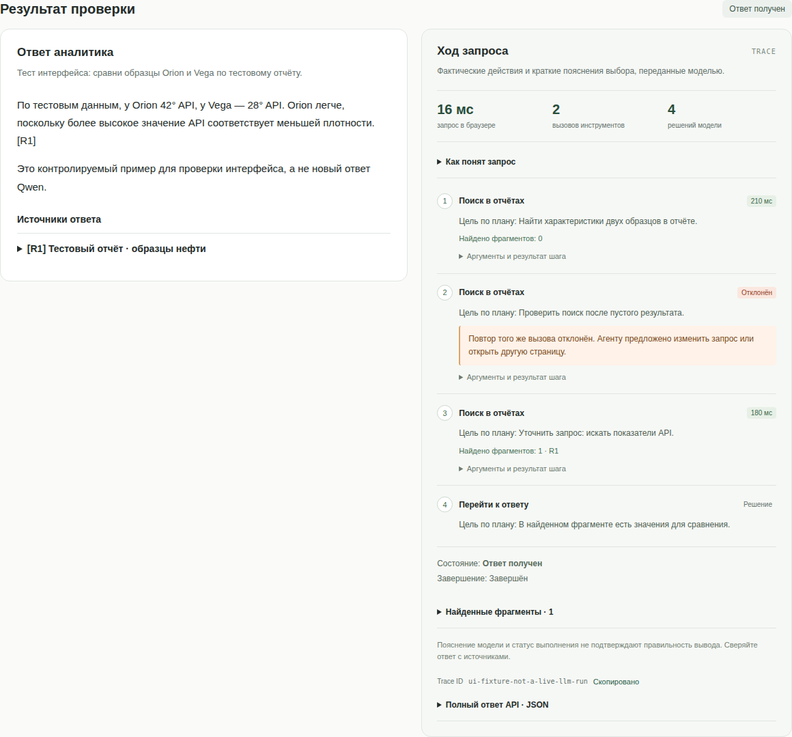
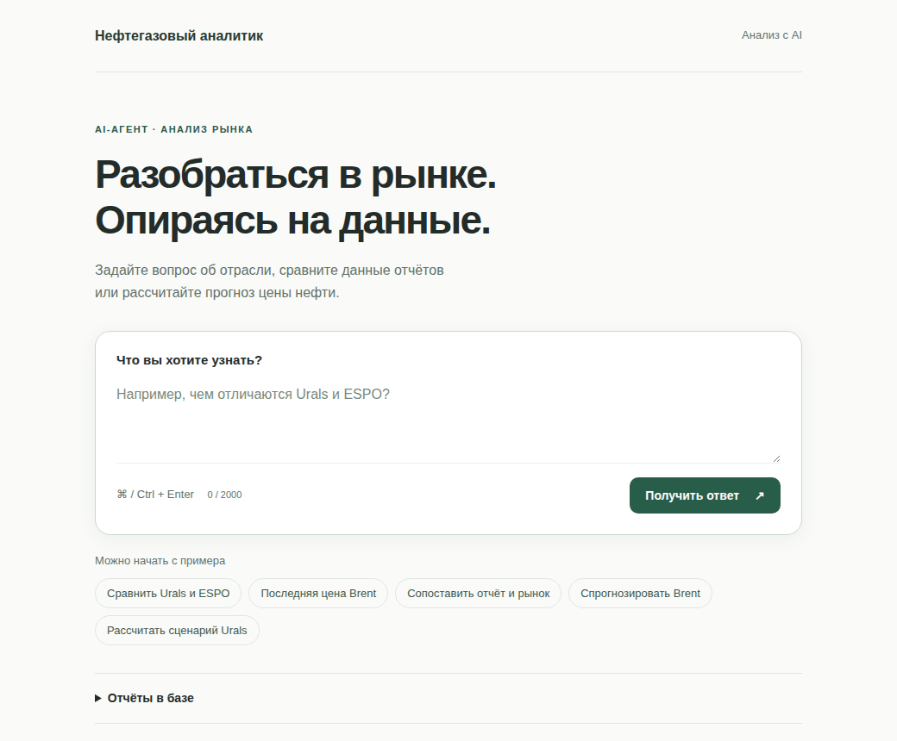
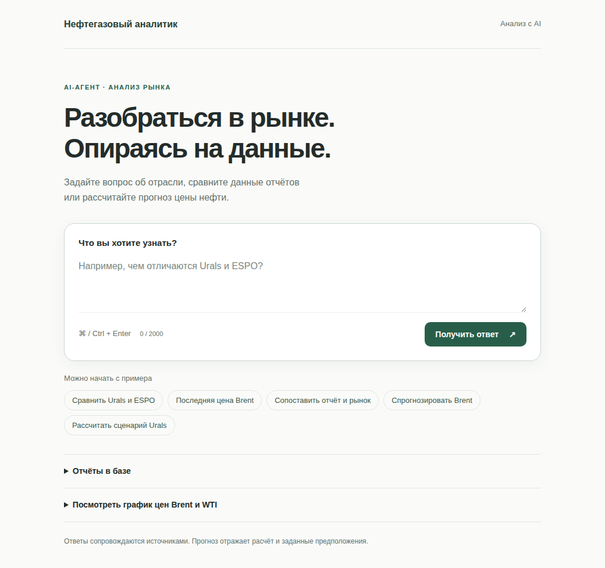
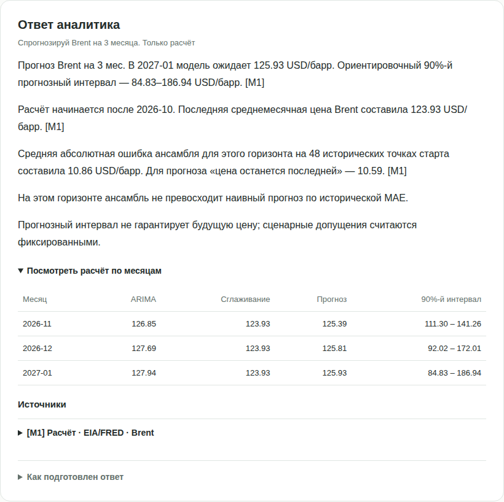
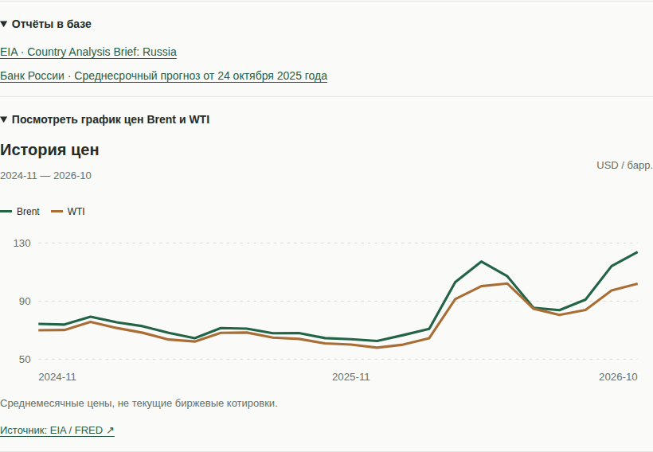

# AI-агент «Нефтегазовый аналитик»

Агент для работы с отраслевыми отчётами, свежими публикациями и расчётом цен нефти. Разработан на **LangGraph и Ouroboros**: модель выбирает следующий инструмент по результатам предыдущего шага. При поиске фактов сначала проверяет загруженные PDF, затем при необходимости обращается к веб-источникам. Прогноз Brent/WTI рассчитывается отдельным инструментом, Urals — как сценарий с заданным дисконтом.

**Стек:** Python 3.12, uv, FastAPI, LangGraph, Ouroboros, FAISS, ONNX-эмбеддеры и Langfuse.

**Третья версия:** ветка `review/v3-knowledge-gigachat-20261114`, созданная из второй архитектуры. Подготовлен отдельный адаптер прямого GigaChat API для физлиц с проверкой JSON-схем. Авторизация и ответы проверяются локально после добавления личного ключа; без ключа не заявляется успешное подключение или улучшение качества. Предыдущие измерения Qwen остаются историческим baseline.

[План после защиты](docs/V3_Roadmap.md) · [Получить ключ и запустить GigaChat](docs/GigaChat.md). OCR, загрузка документов через UI, новые skills и память пока запланированы.

## Тестовый интерфейс

Ответ сопровождается планом, шагами, параметрами инструментов, найденными фрагментами и причинами остановки. Можно скопировать Trace ID и скачать JSON. [Как пользоваться стендом](docs/TestInterface.md).

Найденные фрагменты сразу передаются в подготовку ответа. В стенде видно, какие источники получила модель и что прошло проверку. [Исправление передачи и живые проверки](docs/EvidenceHandoff.md) · [Прогресс и остановка](docs/AgentProgress.md).



На снимке — контролируемый пример проверки интерфейса, не новый прогон Qwen.

<details>
<summary>Прежний пользовательский интерфейс — сохранён в архиве</summary>

[Исходные файлы и восстановление](archive/user-interface-2026-11-11/README.md).



Демонстрация интерфейса на сохранённом ответе [реального прогона Qwen 3B](eval/results/live-qwen-3b-2026-11-10.json).

<details>
<summary>Открыть отдельные скриншоты</summary>

**Стартовый экран**



**Прогноз и расчёт по месяцам**



**Отчёты и график по требованию**



</details>

</details>

## Запуск третьей версии

В проекте GigaChat API откройте **Настройки API → Получить ключ**. В `.env` нужен **Authorization Key**, без префикса `Basic`; временный access token приложение получает автоматически.

```bash
git clone --branch review/v3-knowledge-gigachat-20261114 https://github.com/moomivee/ai_assistant.git ai_assistant_ver_3
cd ai_assistant_ver_3
if [ ! -f .env ]; then cp .env.example .env; fi
nano .env
```

Укажите `GIGACHAT_CREDENTIALS` и оставьте `GIGACHAT_SCOPE=GIGACHAT_API_PERS`. `GIGACHAT_MODEL` — модель из списка, доступного вашему аккаунту; значение из примера является кандидатом, а не гарантией доступа.

```bash
docker compose -f compose.yaml -f compose.gigachat.yaml up --build -d
docker compose -f compose.yaml -f compose.gigachat.yaml exec analyst python -m src.cli check-llm
```

Интерфейс с настройками из `.env.example`: **http://localhost:8003**. `check-llm` проверяет авторизацию и выводит ID моделей без генерации. При необходимости измените `GIGACHAT_MODEL` и пересоздайте `analyst`. Сборка не требует ключа и не обращается к GigaChat.

Для этой версии используется облачная модель; файл `compose.local.yaml` предназначен для прежнего варианта с Ollama. Запуск без Docker, сертификаты, смена ключа и живая проверка ответа описаны в [инструкции GigaChat](docs/GigaChat.md).

## Примеры

- «Каково содержание серы в Sokol? Используй только загруженные отчёты».
- «Покажи последнее опубликованное дневное наблюдение Brent».
- «Сравни экспорт нефти в Индию из отчёта EIA со свежими новостями».
- «Спрогнозируй Brent на 3 месяца. Только расчёт».
- «Напиши лучший музей Москвы» — проверка границ специализации.

## Текущие ограничения

В предыдущих проверках Qwen неверно интерпретировала часть чисел и повторяла действия. Переход на GigaChat ещё требует живого сравнения на тех же вопросах. Проверка JSON, ссылок и чисел не гарантирует правильность смысла. Корпус пока состоит из двух отчётов; OCR и долговременной памяти нет. Без Tavily веб-доступ ограничен RSS и FRED. Прогноз использует сохранённую историю и сценарные допущения; превосходство над наивным прогнозом не гарантировано.

Полный живой eval на 100 вопросах и независимая экспертная проверка ещё не проведены. Подробности — в [результатах и ограничениях](docs/Limitations.md).

## Проверки и документация

```bash
uv run python -m pytest -q
uv run python -m eval.run retrieval
uv run python -m eval.ui
```

Eval-интерфейс: **http://localhost:8001**. В seed-наборе 100 вопросов, из них 40 с эталонными фрагментами PDF; это объём набора, а не число успешно решённых задач. Тесты кода проверяют исполнение и контракты; транспорт GigaChat проверяется с контролируемыми HTTP-ответами, без расхода токенов. Новые живые проверки — в [разборе передачи источников](docs/EvidenceHandoff.md), прежние измерения — в [аудите](docs/AgentAudit.md). Исторический результат фиксированного workflow сохранён в [Results](docs/Results.md).

Актуальная документация архитектуры: [схема и файлы](docs/Architecture.md), [eval](docs/Evaluation.md), [трейсы и промпты](docs/Observability.md), [установка и обновление](docs/Setup.md). 

