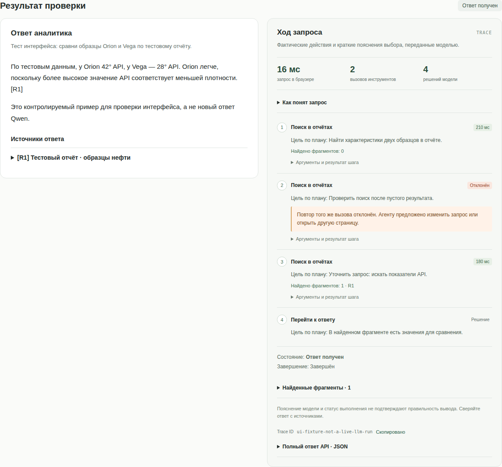
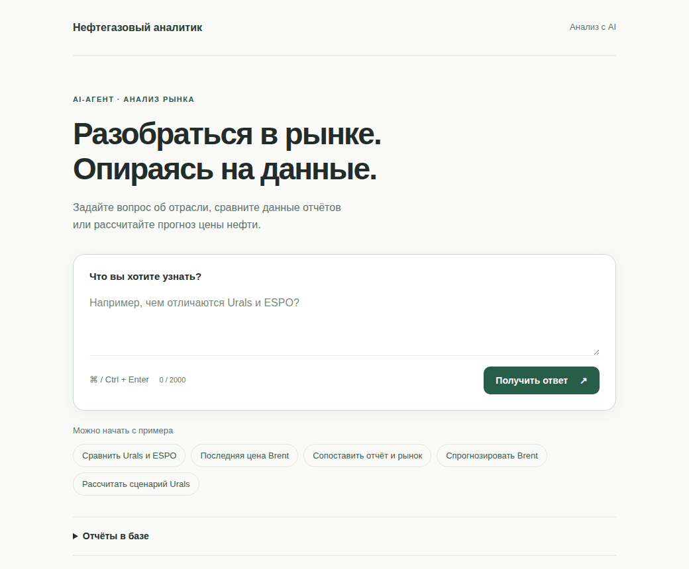
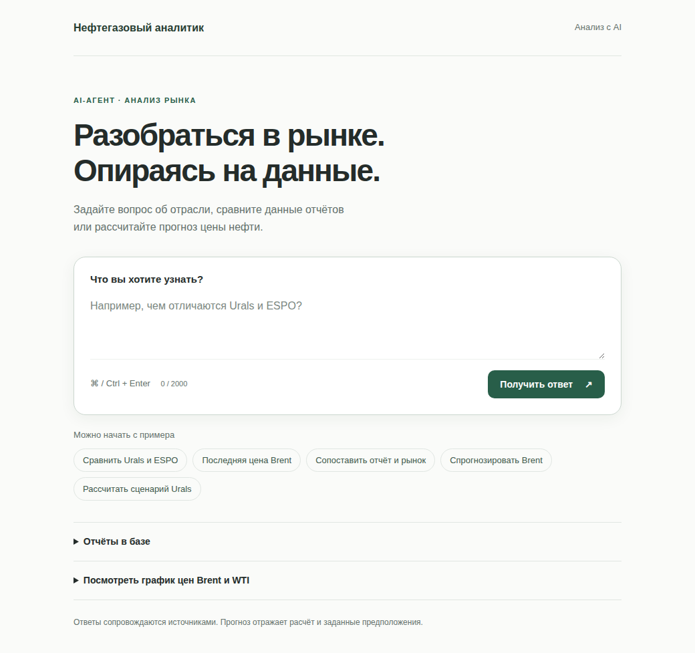
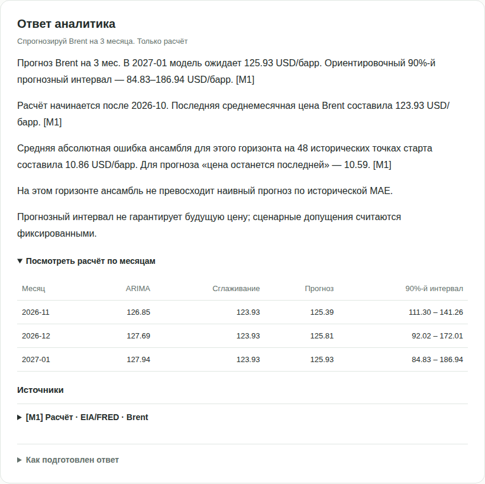
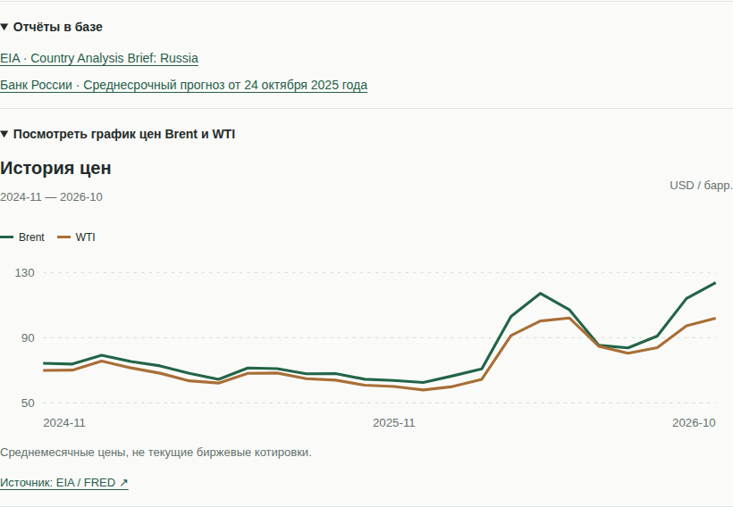

# AI-агент «Нефтегазовый аналитик»

Агент для работы с отраслевыми отчётами, свежими публикациями и расчётом цен нефти. Разработан на **LangGraph и Ouroboros**: модель выбирает следующий инструмент по результатам предыдущего шага. При поиске фактов сначала проверяет загруженные PDF, затем при необходимости обращается к веб-источникам. Прогноз Brent/WTI рассчитывается отдельным инструментом, Urals — как сценарий с заданным дисконтом.

**Стек:** Python 3.12, uv, FastAPI, FAISS, ONNX-эмбеддеры, OpenAI-совместимый LLM-клиент, Langfuse. Локальная Qwen 2.5 3B выбрана как доступная стартовая модель.

**Текущий статус:** учебный прототип агентского цикла в [PR #2](https://github.com/moomivee/ai_assistant/pull/2), ветка `review/agent-eval-20261110`. Реализованные возможности, измерения и известные ограничения собраны [на отдельной странице](docs/Limitations.md).

## Тестовый интерфейс

Ответ сопровождается планом, шагами, параметрами инструментов, найденными фрагментами и причинами остановки. Можно скопировать Trace ID и скачать JSON. [Как пользоваться стендом](docs/TestInterface.md).

В цикле добавлены сведения о недостающих фактах, повторное использование результатов и остановка при отсутствии новых данных или исчерпании времени. [Что изменилось и как проверить](docs/AgentProgress.md).



На снимке — контролируемый пример проверки интерфейса, не новый прогон Qwen.

<details>
<summary>Прежний пользовательский интерфейс — сохранён в архиве</summary>

[Исходные файлы и восстановление](archive/user-interface-2026-11-11/README.md).



Демонстрация интерфейса на сохранённом ответе [реального прогона Qwen 3B](eval/results/live-qwen-3b-2026-11-10.json).

<details>
<summary>Открыть отдельные скриншоты</summary>

**Стартовый экран**



**Прогноз и расчёт по месяцам**



**Отчёты и график по требованию**



</details>

</details>

## Запуск

После установки [uv](https://docs.astral.sh/uv/getting-started/installation/) и [Ollama](https://ollama.com/download):

```bash
git clone --branch review/agent-eval-20261110 https://github.com/moomivee/ai_assistant.git
cd ai_assistant
cp -n .env.example .env
uv sync --locked
ollama pull qwen2.5:3b
uv run python -m src.cli prepare
uv run uvicorn src.api:app --host 127.0.0.1 --port 8000
```

Ollama должна быть запущена с контекстом **8192 токена**; настройка и обновление описаны в [инструкции](docs/Setup.md). Интерфейс: **http://localhost:8000**. Запуск приложения и Ollama в Docker:

```bash
docker compose -f compose.yaml -f compose.local.yaml up --build -d
```

## Примеры

- «Каково содержание серы в Sokol? Используй только загруженные отчёты».
- «Покажи последнее опубликованное дневное наблюдение Brent».
- «Сравни экспорт нефти в Индию из отчёта EIA со свежими новостями».
- «Спрогнозируй Brent на 3 месяца. Только расчёт».
- «Напиши рецепт борща» — проверка границ специализации.

## Текущие ограничения

Qwen иногда неверно интерпретирует найденные числа, повторяет поиск и добавляет лишние действия. Проверка JSON, ссылок и чисел не гарантирует правильность смысла. Корпус пока состоит из двух отчётов; OCR и долговременной памяти нет. Без Tavily веб-доступ ограничен RSS и FRED. Прогноз использует сохранённую историю и сценарные допущения; превосходство над наивным прогнозом не гарантировано.

Полный живой eval на 100 вопросах и независимая экспертная проверка ещё не проведены. Подробности — в [результатах и ограничениях](docs/Limitations.md).

## Проверки и документация

```bash
uv run python -m pytest -q
uv run python -m eval.run retrieval
uv run python -m eval.ui
```

Eval-интерфейс: **http://localhost:8001**. В seed-наборе 100 вопросов, из них 40 с эталонными фрагментами PDF; это объём набора, а не число успешно решённых задач. **125 тестов кода** проверяют исполнение и контракты. Живые прогоны Qwen, изменения агентского цикла и ограничения — в [аудите](docs/AgentAudit.md). Исторический результат фиксированного workflow сохранён в [Results](docs/Results.md).

Актуальная документация архитектуры: [схема и файлы](docs/Architecture.md), [eval](docs/Evaluation.md), [трейсы и промпты](docs/Observability.md), [установка и обновление](docs/Setup.md). 

