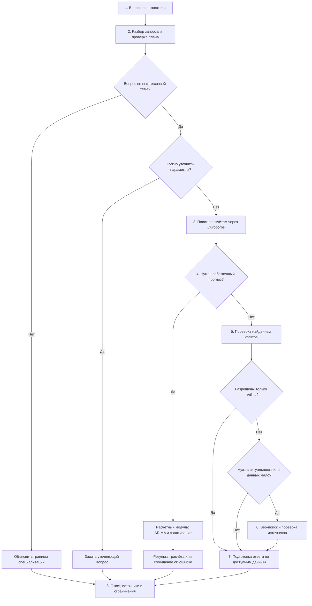
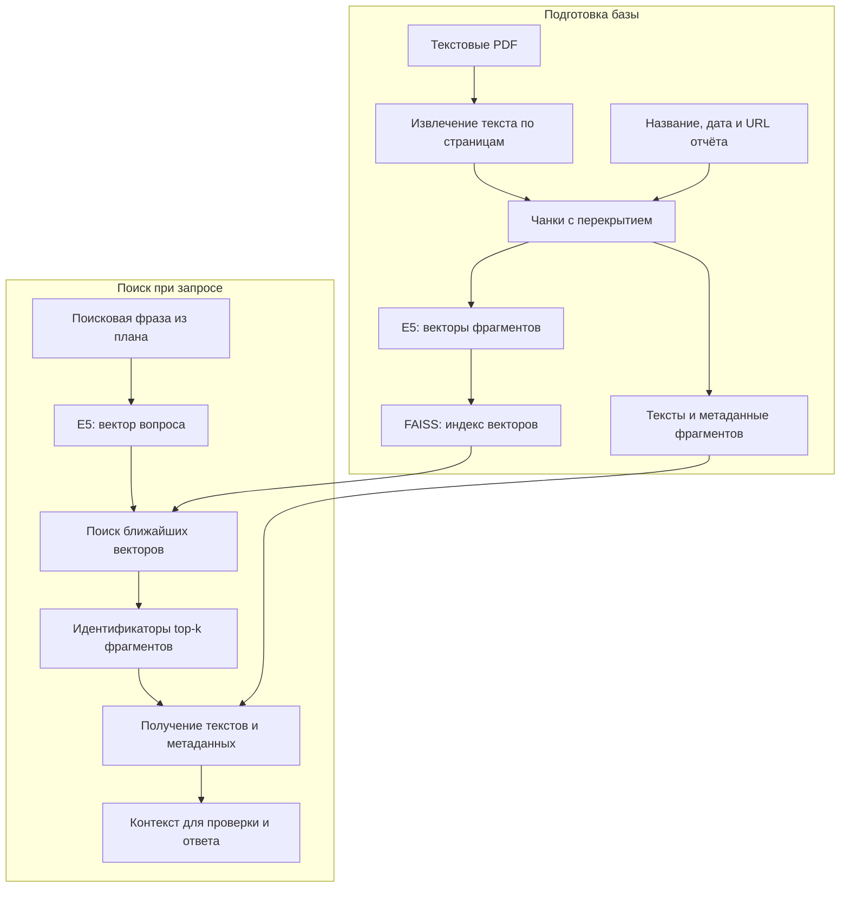
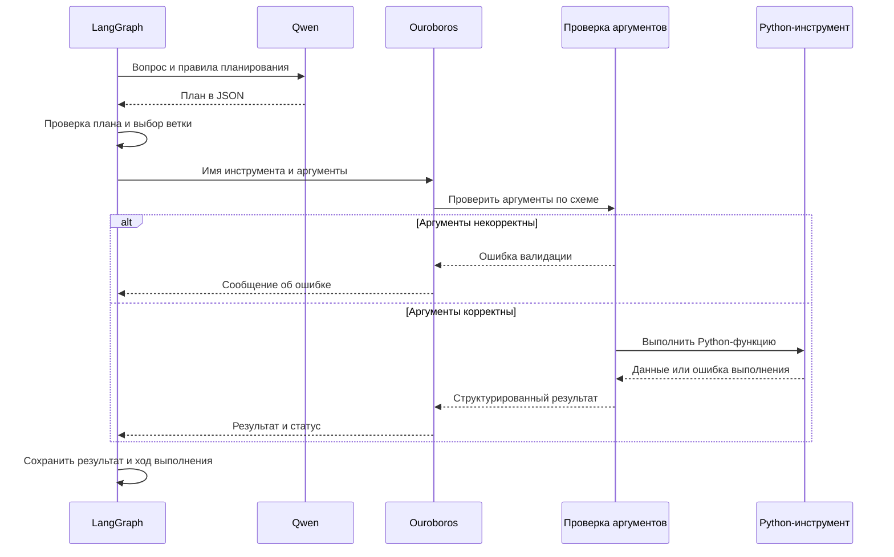
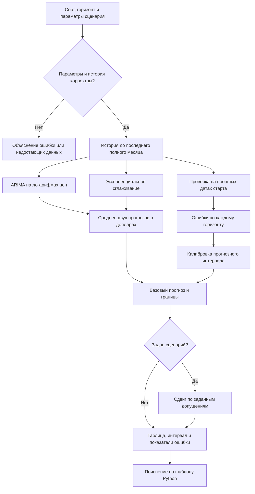

# AI-агент «Нефтегазовый аналитик»

Разработка AI-агента на Python с использованием Ouroboros. Цель — создать помощника в роли старшего аналитика нефтегазового рынка, который отвечает на отраслевые вопросы, находит подтверждения в отчётах и открытых источниках и вызывает расчётный модуль для прогнозирования цен на нефть.

**Статус: в разработке.** 

## Реализация

- **Отраслевая экспертиза:** Upstream, Midstream, Downstream, Brent, WTI, Urals, ОПЕК+, санкции, спрос и предложение.
- **RAG по отчётам:** загрузка PDF, разбиение на фрагменты, векторный поиск top-k и сохранение названия отчёта, даты и страницы.
- **Веб-поиск:** получение свежих новостей и котировок с ограничением круга источников и проверкой дат публикаций.
- **Прогнозирование:** отдельный инструмент с историческими данными, двумя методами ARIMA и экспоненциальным сглаживанием, прогнозным интервалом и пояснением результата.
- **Проверяемые ответы:** структурированный текст, цифры со ссылками, явное указание неопределённости и корректную обработку вопросов вне компетенции агента.

## Архитектура и технологии

| Компонент | Назначение |
| --- | --- |
| Язык | Python 3.12 |
| Ouroboros | Регистрация и выполнение инструментов поиска и прогнозирования |
| LangGraph | Управление шагами агента и переходами между ними |
| LLM | Локальная Qwen через Ollama: анализ запроса, выбор нужных действий и формирование ответа |
| RAG | multilingual-e5 для векторизации и FAISS для поиска фрагментов |
| Интернет-поиск | Tavily с фильтрацией доменов и проверкой результатов |
| Интерфейс | FastAPI и простой веб-интерфейс |
| Запуск | Docker Compose; ключи и параметры в `.env` |

Я выбрала локальную Qwen (через Ollama), чтобы запускать модель на своём MacBook и разрабатывать проект без обязательного обращения к платному LLM API. Качество её ответов и выбора инструментов будет проверено на демонстрационных сценариях. Численные прогнозы будет рассчитывать отдельный Python-модуль.

## Как будет работать агент

Я строю агента вокруг трёх действий: найти сведения в отчётах, дополнить их актуальными источниками и при необходимости выполнить численный расчёт. Последовательность действий задаю в LangGraph, работу инструментов подключаю через Ouroboros, а Qwen использую для разбора запроса и подготовки ответа по найденным данным.

Ниже архитектура, которую воспроизвожу в своей сборке. Она опирается на подготовленный прототип; ограничения прототипа отмечены в комментариях. В базу планирую включить отчёты ОПЕК, МЭА и EIA. Сейчас в демонстрационном наборе есть документы EIA и Банка России.

### 1. Общая схема обработки запроса



| Шаг | Мой комментарий |
| --- | --- |
| **1. Вопрос** | Пользователь пишет обычным языком. Интерфейс передаёт текст в API. Если это ответ на уточнение, вместе с ним передаётся предыдущий незавершённый вопрос. |
| **2. План** | Qwen помогает определить тип задачи: поиск сведений, собственный прогноз или вопрос вне специализации. План содержит поисковую фразу, необходимость свежих данных, сорт нефти, горизонт и явно заданные сценарные параметры. Python проверяет формат и ограничения плана. |
| **Уточнение** | Если не хватает необходимого параметра, агент спрашивает его у пользователя. Ответ пользователя запускает новый проход обработки с учётом уточнения. Например, для сценария Urals нужен дисконт к Brent. |
| **3. Отчёты** | Для принятого отраслевого запроса первым инструментом вызывается `report_search`. Код получает фрагменты с метаданными, а не загружает всю библиотеку PDF в контекст модели. |
| **4. Прогноз** | «Что прогнозирует EIA в отчёте?» — задача поиска. «Рассчитай прогноз Brent на три месяца» — вызов `price_forecast`. В прототипе это разные ветки графа. |
| **5. Достаточность** | Найти похожий фрагмент недостаточно: нужно проверить, отвечает ли он на вопрос. Для известных таблиц есть извлечение фактов кодом; для произвольных вопросов используется Qwen и проверка её утверждений по выдержкам. |
| **6. Интернет** | `web_search` подключается для свежих новостей, последних котировок или восполнения пробелов. Явное требование «только по отчётам» блокирует эту ветку. |
| **7. Подготовка ответа** | В ответ попадают подтверждённые доступными материалами сведения. Если удалось найти только часть, агент обозначает пробел. Ошибка инструмента сохраняется как сообщение, а не заменяется выдуманным результатом. |
| **8. Результат** | Пользователь получает текст, ссылки, даты, при необходимости таблицу прогноза и сообщения об ограничениях. В интерфейсе прототипа также видны вызванные инструменты, их статусы и время выполнения. |

В текущем прототипе ветка собственного прогноза после поиска по PDF сразу переходит к расчёту. Она не выполняет дополнительный веб-поиск для объяснения прогноза новостями. Совместный анализ «прогноз + свежие события» потребует расширения графа. Предварительный поиск по отчётам сам по себе не означает, что их текст используется как вход численной модели.

### 2. Как устроен RAG: подготовка документов и поиск

Я разделяю подготовку базы и обработку вопроса. Документы преобразуются в индекс заранее или при первом обращении; при следующих вопросах используется готовый индекс. При изменении зарегистрированных документов индекс нужно обновить.



**Что происходит внутри:**

1. Я помещаю текстовые PDF в `data/reports/` и регистрирую их название, дату, URL и имя файла в `data/reports.json`. 
2. Из каждой страницы извлекается текст. Он делится на чанки (небольшие фрагменты с перекрытием), чтобы меньше терять контекст на границах.
3. Каждый фрагмент получает метаданные: название и дату отчёта, номер физической страницы PDF, ссылку на источник. 
4. Embedding-модель multilingual-e5 преобразует тексты в числовые векторы. FAISS хранит индекс векторов; тексты и метаданные сохраняются рядом с ним.
5. Поисковая фраза преобразуется той же моделью с префиксом для запроса. FAISS находит ближайшие векторы и возвращает top-k (заданное количество фрагментов).
6. Тексты найденных фрагментов передаются на проверку достаточности и подготовку ответа. Высокая близость векторов ещё не доказывает, что в фрагменте есть нужный ответ.

В прототипе чанк содержит до **110 слов**, перекрытие **28 слов**, `top-k` по умолчанию равен **6**. Короткие остатки и страницы без достаточного извлекаемого текста могут быть пропущены. 

**Ограничение:** Сканированные PDF потребуют отдельного OCR (распознавания текста), такого этапа сейчас нет.
**E5 и Qwen выполняют разные задачи:** E5 помогает найти подходящий текст. Qwen читает отобранный текст и формулирует ответ. 

### 3. Как Qwen, LangGraph и Ouroboros работают вместе

В моей реализации Qwen возвращает структурированный план в JSON. По этому плану LangGraph выбирает предусмотренную ветку обработки. Имена инструментов и допустимые аргументы определены в Python-коде.



| Компонент | За что он отвечает |
| --- | --- |
| **Qwen** | Помогает понять намерение пользователя, составить поисковую фразу, оценить полноту найденных сведений и сформулировать подтверждаемые ими утверждения. |
| **Ollama** | Запускает локальную модель и предоставляет API, к которому обращается Python-приложение. Cервер модели. |
| **LangGraph** | Хранит состояние запроса и управляет переходами: отчёты, проверка, интернет, расчёт, финальный ответ. |
| **Ouroboros** | Содержит реестр разрешённых инструментов и выполняет их через `ToolRegistry.execute_result`. |
| **Pydantic и обработчики Python** | Проверяют типы и допустимые значения аргументов, затем вызывают нужную функцию. Дополнительные проверки данных выполняются внутри самих инструментов. |
| **Инструменты** | `report_search` ищет по PDF; `web_search` получает публикации и котировки; `price_forecast` выполняет расчёт. |


### 4. Когда нужен интернет и как выбираются источники

Я использую приоритет отчётов с учётом **показателя и периода**, о которых спрашивает пользователь. Например, прошлогодний отчёт может объяснять структуру отрасли, но не подтверждать сегодняшнюю цену.

| Ситуация | Что делает агент |
| --- | --- |
| В отчётах найден достаточный ответ, свежесть не требуется | Формирует ответ на основе отчётов, без веб-поиска. |
| Нужны последние новости или котировки | Добавляет веб-источники, даже если в отчётах есть общая информация по теме. |
| В отчётах нет полного ответа | Пробует дополнить материалы через интернет. |
| Пользователь написал «только по отчётам» | Не обращается к интернету; сообщает, если отчётов недостаточно или они не подтверждают актуальность. |
| Веб-сервис недоступен или подходящих результатов нет | Возвращает доступные сведения и объясняет, какую часть запроса подтвердить не удалось. |

**Для котировок Brent и WTI** прототип обращается к дневным рядам EIA через FRED. В ответе указывается дата последнего опубликованного наблюдения: это не биржевая цена в реальном времени. Прямой аналогичный ряд Urals в проект не подключён.

**Для общего поиска** используется Tavily: разрешённые домены задаются в запросе, а затем повторно проверяются в полученных результатах. Для свежих новостей отбрасываются публикации без распознанной даты, с будущей датой или старше установленного окна. В обычном поиске наличие даты не гарантируется, поэтому недатированный материал нельзя представлять как подтверждение свежести.

Без ключа Tavily доступен ограниченный поиск свежих публикаций по RSS EIA и Банка России. Фильтрация по издателям и датам уменьшает риск нерелевантных публикаций, но не заменяет проверку содержания. Реальная работа Tavily с ключом требует отдельной проверки; в имеющихся тестах используется имитация ответа сервиса.

### 5. Как работает расчётный модуль

Я отделяю расчёт цены от генерации текста. Инструмент получает сорт нефти, горизонт и явно заданные сценарные параметры. Для Brent и WTI он работает с историей среднемесячных цен в `data/prices/monthly.csv`.



**Комментарии к расчёту:**

1. **Входные данные.** Поддерживается горизонт от 1 до 12 месяцев. Проверяется наличие не менее 72 последовательных полных месяцев, порядок дат и положительные конечные значения цен. Горизонт отсчитывается от последнего наблюдения в CSV, поэтому старый файл нужно обновлять.
2. **Два метода.** В прототипе используются ARIMA(1,1,0) без дрейфа и простое экспоненциальное сглаживание. Оба метода работают с логарифмами цен; результаты переводятся обратно в доллары и усредняются.
3. **Проверка на истории.** На каждой прошлой дате старта модели получают только уже известные к тому моменту данные. Затем прогноз сравнивается с реально наблюдавшимися следующими месяцами.
4. **Интервал.** По прошлым ошибкам отдельно для каждого горизонта строится ориентировочный 90%-й прогнозный интервал. Такая калибровка не гарантирует будущего покрытия, особенно при изменении рыночного режима.
5. **Ориентир для сравнения.** Показывается средняя абсолютная ошибка модели и простого прогноза «цена останется последней известной». Наличие двух методов само по себе не доказывает улучшения точности.
6. **Urals.** Сценарий рассчитывается как прогноз Brent минус заданный пользователем дисконт. Неопределённость самого дисконта в интервал не включается.
7. **Сокращение добычи.** Сценарная надбавка равна заданному сокращению, умноженному на заданную чувствительность цены. Это условный расчёт, а не самостоятельно оценённая причинная модель рынка.
8. **Ответ.** В текущем прототипе таблицу и пояснение прогноза формирует Python по шаблону. Qwen не рассчитывает численные значения и не переписывает результат этой ветки.

### 6. Как проверяется и оформляется ответ

Для исследовательской ветки Qwen получает найденные материалы и возвращает утверждения с идентификатором источника и точной выдержкой. Затем Python проверяет, существует ли указанный источник, присутствует ли выдержка в его тексте и встречаются ли числа из утверждения в выдержке или дате источника. Непрошедшие проверку утверждения не включаются в список принятых фактов.

Проверка совпадения цитат и чисел не доказывает правильность вывода: модель всё ещё может неверно истолковать текст, единицы измерения или связь показателей. Поэтому в ответе сохраняются ссылки для проверки первоисточника. Для нескольких известных табличных вопросов факты извлекаются непосредственно кодом.

| Маркер | Что я показываю рядом с ним |
| --- | --- |
| **`[R1]` — отчёт** | Название, дата публикации, физическая страница PDF и ссылка. Период самого показателя уточняется по тексту. |
| **`[W1]` — веб** | Источник, URL и доступная дата публикации либо наблюдения. Последнее наблюдение цены может быть опубликовано с задержкой. |
| **`[M1]` — расчёт** | Метод, дата окончания истории, горизонт, единицы измерения, прогнозный интервал и сценарные допущения. |

Идентификаторы относятся к материалам конкретного ответа. Если сведения подтверждают только часть вопроса, агент сообщает об этом. Если подтверждённых фактов нет, он прямо пишет о недостатке данных и может показать ближайшие найденные материалы для самостоятельной проверки.


## Запуск

Целевой способ запуска после сборки приложения:

```bash
cp .env.example .env
# Здесь я заполняю параметры модели и ключ веб-поиска в .env.
docker compose up --build
```

Эта команда станет доступна после добавления исходников и файлов Docker. Точные настройки локальной Qwen и адрес интерфейса я добавлю после проверки запуска. Отчёты и исторические данные размещу в `data/` либо предусмотрю скрипт их загрузки.


## Ограничения и дальнейшая работа

Качество ответов зависит от полноты отчётов, качества извлечения текста и актуальности данных. Фильтрация веб-источников снижает риск недостоверной информации, но не гарантирует её правильность. Прогнозы остаются вероятностными; оценка влияния сокращения добычи потребует явных сценарных допущений.

После основной реализации я планирую расширить базу отчётов, оценить качество поиска и ссылок, а прогнозы проверить на исторических данных и сравнить с простым ориентиром «будущая цена равна последней известной».
