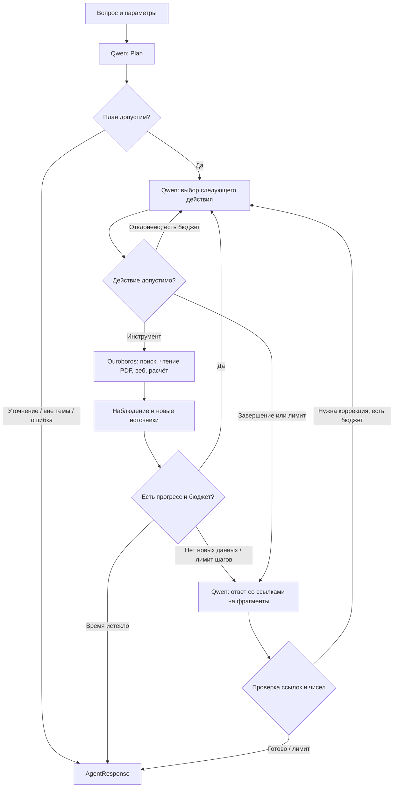

# Архитектура агента

Агент работает в ограниченном цикле LangGraph: после каждого результата Qwen выбирает следующий шаг. Один запрос может потребовать нескольких поисков, чтения страницы PDF, веб-поиска и расчёта. Порядок этих действий не записан одной обязательной цепочкой.

## Кто принимает решения

Qwen интерпретирует запрос, составляет поисковые формулировки, выбирает инструменты и решает, достаточно ли собранных сведений. При неполном ответе получает обратную связь и может продолжить поиск. Это последовательные решения по наблюдениям, а не выбор единственной готовой ветки в начале запроса.

Код обеспечивает границы: веб разрешён после попытки поиска в отчётах и запрещён при `report_only`; расчёт принимает только проверенные параметры; одинаковый вызов не повторяется; число решений ограничено `AGENT_MAX_STEPS` (по умолчанию 6). Допустимые действия передаются и в JSON Schema. Это ограничение инструментов, а не заранее заданный ответ.

В том же решении модель заполняет `evidence_checks` и `missing_facts`: какие сведения вопроса найдены и чего ещё не хватает. Повтор возвращает ссылку на предыдущий результат, сохраняя возможность изменить аргументы этого инструмента. Контроллер учитывает новые тексты и расчёты; после двух последовательных попыток без них переходит к ответу. Общий бюджет обработки по умолчанию — 180 секунд. Это кооперативный предел: проверяется между этапами и ограничивает таймауты LLM и веб-клиентов, но не прерывает произвольную синхронную операцию. [Подробности и ограничения](AgentProgress.md).

Для чистого прогноза достаточно `price_forecast`. Приоритет RAG применяется к поиску внешних фактов; загрузка случайного фрагмента PDF перед расчётом не улучшает прогноз. Числа прогноза и их стандартное пояснение формируются расчётным модулем. Произвольный анализ по источникам формулирует модель.

## Инструменты

| Инструмент | Назначение |
|---|---|
| `report_search` | Найти фрагменты PDF; модель может менять запрос и искать повторно |
| `read_report` | Открыть физическую страницу найденного отчёта, сохранив строки и заголовки таблицы |
| `web_search` | Получить сведения из разрешённых веб-источников или дневные наблюдения FRED |
| `price_forecast` | Выполнить расчёт на заданный горизонт, без придумывания сценарных параметров |

Все четыре инструмента исполняются через `ouroboros.ToolRegistry`. Используется structured JSON для выбора действия; нативный протокол `tool_calls` в текущую реализацию не включён. От того, в каком протоколе передано действие, само по себе не зависит наличие агентского цикла.

## Ответ и проверка

Источникам назначаются устойчивые в пределах запроса ID. Небольшой исходный блок имеет адрес, например `R2:B1`. Заголовок и строки небольшой таблицы сохраняются вместе. Модель указывает эти адреса; цитаты подставляет код из фактически полученного документа. Несколько блоков можно использовать вместе, не выдавая их за одну дословную непрерывную цитату.

Неизвестные адреса и числа без подтверждения отклоняются. Самопроверка той же моделью оставлена только как эксперимент `ANSWER_SELF_REVIEW=true`; по умолчанию она отключена. В живых прогонах она принимала неправильные интерпретации и отклоняла правильные. Проверка ссылок и чисел остаётся обязательной, но сама по себе не доказывает правильность смысла. Внешняя оценка и её ограничения описаны в [аудите](AgentAudit.md).

`AgentResponse.diagnostics` дополнительно передаёт проверенный план, результаты исполнения с номерами решений, найденные фрагменты и замечания. [Тестовый интерфейс](TestInterface.md) показывает те же сведения о прогрессе и повторах, которые передаются модели в наблюдениях; полный объект диагностики в контекст не добавляется. Для прежнего workflow диагностика может отсутствовать.

`AgentResponse` содержит текст, использованные источники, утверждения с адресами доказательств, прогноз, выполненные инструменты, решения, причину остановки и trace ID. Статус `ok` означает прохождение реализованных проверок, а не экспертную гарантию истинности. `partial`, `clarification`, `outside` и `unavailable` различают неполный ответ, уточнение, выход за специализацию и недоступность модели.

## Где находится код

| Путь | Ответственность |
|---|---|
| `src/agent.py` | Агентский цикл LangGraph, ограничения, наблюдения, выбор следующего действия |
| `src/progress.py`, `src/budget.py` | Сопоставление повторов, новизна содержимого и общий бюджет обработки |
| `src/evidence.py` | Адресация блоков, генерация и проверка ссылок и чисел по выбранным доказательствам |
| `src/planning.py` | Параметры прогноза и явно запрошенные дополнительные задачи |
| `src/workflow.py`, `src/answering.py` | Сохранённая прежняя реализация для сравнения; `AGENT_MODE=workflow` |
| `src/models/schemas.py` | Схемы плана, действий, ответов и оценок |
| `src/integrations/llm.py` | OpenAI-совместимый клиент и JSON Schema |
| `src/integrations/telemetry.py` | Langfuse callbacks и локальные JSONL-трейсы |
| `src/integrations/prompts.py`, `prompts/` | Версии локальных промптов и Langfuse |
| `src/rag/index.py` | PDF, чанки, эмбеддинги, FAISS и эксперимент BM25/RRF |
| `src/tools.py` | Схемы аргументов и инструменты Ouroboros |
| `src/calculations/forecast.py` | ARIMA/SES, интервалы, бэктест |
| `src/api.py`, `src/cli.py`, `src/static/` | API, команды и интерфейс |
| `eval/` | Оценка маршрутов, ответов, поиска и оценщика |
| `tests/` | Проверки кода; отдельно от оценки настоящей модели |

Долговременная память и автономные фоновые задачи не реализованы. `previous` предназначен для уточнения запроса. Наличие нескольких моделей или нескольких агентов не является обязательным условием агентского поведения.

## RAG

PDF разбиваются по физическим страницам: окно 110 слов, шаг 82 слова. Исходные переносы строк сохраняются, чтобы строки таблиц не превращались в одну длинную строку. Это не полноценный парсер таблиц; сложные макеты всё ещё требуют проверки. Сохраняются отчёт, дата, страница, ссылка и стабильный `chunk_id`. Сканированные страницы без текстового слоя не распознаются. Индекс FAISS использует нормированные эмбеддинги и скалярное произведение, эквивалентное cosine similarity.

Эмбеддеры: `e5-small` с префиксами `query:`/`passage:` и `minilm-multi`. Модели загружаются в квантизованном ONNX-виде по зафиксированной ревизии и проверяются SHA256. Ключ индекса включает модель, настройки разбиения, реестр и хеши PDF. Смена модели создаёт другой индекс.

Приоритет ОПЕК/МЭА/EIA — правило работы с загруженными источниками. Сейчас в репозитории есть EIA Russia 2025 и прогноз Банка России 2025. Чтобы добавить отчёт, нужно сохранить PDF и заполнить `data/reports.json` с проверенной датой, ссылкой и SHA256, затем выполнить `prepare`. Автоматической загрузки произвольных файлов из UI нет.

## Прогноз

Используется сохранённый CSV среднемесячных Brent/WTI. ARIMA(1,1,0) оценивается условным МНК на логарифмических разностях без дрейфа, SES подбирает alpha по ошибкам внутри обучающего окна. Ансамбль — среднее двух прогнозов. Для каждого горизонта выполняется rolling-origin бэктест: будущие значения не участвуют в обучении соответствующего старта.

90%-й интервал калибруется по абсолютным логарифмическим ошибкам. На финансовом временном ряду это ориентировочный прогнозный интервал: стационарность ошибок не гарантирована. MAE ансамбля сравнивается с прогнозом «последняя цена без изменений». Urals = Brent − заданный дисконт, сценарий сокращения добавляет `cut × sensitivity`. Это фиксированные допущения.

Границы реализованного и проведённых проверок собраны в [текущем результате и ограничениях](Limitations.md).
