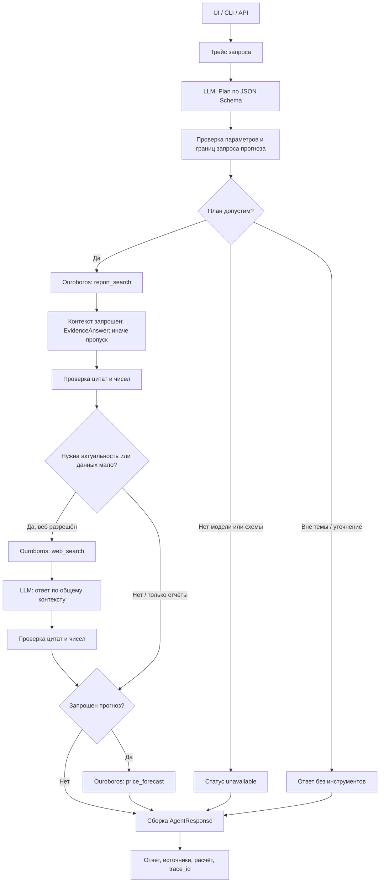

# Архитектура агента

Цель проекта — отвечать на нефтегазовые вопросы с проверяемыми источниками и вызывать отдельный расчёт для прогнозов. Модель интерпретирует запрос и формулирует подтверждённые утверждения. Исполняемый код задаёт допустимые переходы, порядок источников и границы расчёта.

## Полный проход запроса

1. API проверяет длину вопроса, создаёт HTTP request ID. `ask()` создаёт отдельный trace ID, сохраняя связь с HTTP-запросом.
2. LLM получает вопрос, дату и необязательное предыдущее сообщение. Возвращает `Plan`: намерение, поисковый запрос, актуальность, ограничения источников, сорт, горизонт и параметры сценария.
3. OpenAI SDK отправляет `response_format` с JSON Schema. Pydantic проверяет структуру; `validation.py` проверяет допустимость параметров. Для дисконта и сценарных допущений нужна цитата из пользовательского ввода. Это снижает риск придуманного параметра, но не доказывает смысловую корректность плана.
Если план прогноза неполон или модель предлагает уточнение, `planning.py` один раз запрашивает более узкую схему `ForecastInputs`. Новые значения принимаются с цитатами из исходного запроса. Если параметра действительно нет, агент спрашивает пользователя; сорт и сценарные допущения по умолчанию не подставляются.

Если валидный план прогноза предлагает также контекст, новости или текущие котировки, отдельный вызов с небольшой схемой `ForecastScope` проверяет, запрошены ли они явно. Для дополнительной задачи нужна дословная часть пользовательского вопроса. Само «спрогнозируй Brent на 3 месяца» не обосновывает обзор спроса, санкций или новостей. После проверки корректируются флаги и запрос поиска. Эти проверки ограничены: максимум один вызов для параметров и один для дополнительных задач. Для уже полного плана чистого расчёта они не нужны.

4. Для валидного профильного запроса первым вызывается `report_search`, даже если затем нужен прогноз или текущая котировка. Внепрофильный запрос, недоступная модель и уточнение обходятся без инструментов.
5. Если нужен текстовый контекст, LLM формирует `EvidenceAnswer`. Для смешанного прогноза ей передаётся только отдельно запрошенный вопрос о рынке, без требования найти будущий расчёт в PDF. Для чистого расчёта этот шаг пропускается. Каждое утверждение имеет ID источника и точную цитату. Код отклоняет неизвестные ID, отсутствующие цитаты и числа, которых нет в цитате/дате источника.
6. `complete` — оценка достаточности самим LLM, а не установленная истина. При нехватке контекста или запросе актуальности граф обращается в веб. `report_only` запрещает этот переход.
7. После веб-поиска ответ формируется повторно по совокупному контексту и проходит те же проверки. Для чистой котировки текст может собираться непосредственно из типизированного результата FRED.
8. При `intent=forecast` выполняется расчёт. Его цифры и текст собираются кодом, без пересчёта LLM. При смешанном запросе возможны и веб-контекст, и прогноз. Расчёт выводится первым. Если дополнительный вопрос не подтверждён, код сообщает именно об этом вопросе; свободные `limitations` модели из проверки отчётов не используются как оценка готовности расчёта. Ошибки самого инструмента сохраняются. Для чистого прогноза Tavily не нужен.
9. API возвращает `AgentResponse`: текст, источники, claims, forecast, список инструментов, статус и trace ID. UI показывает график и технические подробности по раскрытию.

Статусы: `ok`, `partial`, `clarification`, `outside`, `unavailable`. `ok` означает успешное прохождение текущих проверок, а не экспертную гарантию истинности. Отсутствие модели не заменяется скрытым regex-маршрутизатором.

## Где находится код

| Путь | Ответственность |
|---|---|
| `src/api.py` | FastAPI, запросы, HTTP-логи, health/readiness, PDF и статика |
| `src/cli.py` | Подготовка индекса, вопрос в терминале, обновление цен, публикация промптов |
| `src/agent.py` | Узлы LangGraph, переходы, состояние одного запроса, итоговый ответ |
| `src/planning.py` | Проверка параметров прогноза и явно запрошенных дополнительных задач |
| `src/models/schemas.py` | Plan, ForecastInputs, ForecastScope, EvidenceAnswer, JudgeResult, AgentResponse |
| `src/integrations/llm.py` | Единственная точка вызова LLM; OpenAI SDK и structured outputs |
| `src/integrations/telemetry.py` | Langfuse, native callbacks, локальные JSONL-трейсы |
| `src/integrations/prompts.py` | Локальные промпты и версии Langfuse |
| `src/integrations/web.py` | Tavily, домены, даты публикаций, EIA/FRED |
| `src/integrations/feeds.py` | Ограниченный поиск по RSS EIA/Банка России |
| `src/rag/index.py` | PDF, чанки, эмбеддинги, FAISS и кэш |
| `src/rag/embedders.json` | Версии, префиксы, параметры и SHA256 моделей |
| `src/calculations/forecast.py` | История, ARIMA/SES, бэктест и интервалы |
| `src/tools.py` | Схемы аргументов и регистрация трёх инструментов Ouroboros |
| `src/validation.py` | Проверки параметров и доказательных цитат |
| `src/logging.py` | JSON-логи с request ID |
| `src/static/` | HTML/CSS/JS пользовательского интерфейса |
| `prompts/` | plan.txt, forecast.txt, forecast_scope.txt, answer.txt, judge.txt |
| `eval/` | Данные, метрики, CLI/UI, преобразование трейсов |
| `tests/` | Контрактные и интеграционные проверки без внешней LLM |
| `data/` | PDF, реестр источников, месячная история цен |

## RAG

PDF разбиваются по физическим страницам: окно 110 слов, шаг 82 слова. Сохраняются отчёт, дата, страница, ссылка и стабильный `chunk_id`. Сканированные страницы без текстового слоя не распознаются. Индекс FAISS использует нормированные эмбеддинги и скалярное произведение, эквивалентное cosine similarity.

Эмбеддеры: `e5-small` с префиксами `query:`/`passage:` и `minilm-multi`. Модели загружаются в квантизованном ONNX-виде по зафиксированной ревизии и проверяются SHA256. Ключ индекса включает модель, настройки разбиения, реестр и хеши PDF. Смена модели создаёт другой индекс.

Приоритет ОПЕК/МЭА/EIA — правило работы с загруженными источниками. Сейчас в репозитории есть EIA Russia 2025 и прогноз Банка России 2025. Чтобы добавить отчёт, нужно сохранить PDF и заполнить `data/reports.json` с проверенной датой, ссылкой и SHA256, затем выполнить `prepare`. Автоматической загрузки произвольных файлов из UI нет.

## Прогноз

Используется сохранённый CSV среднемесячных Brent/WTI. ARIMA(1,1,0) оценивается условным МНК на логарифмических разностях без дрейфа, SES подбирает alpha по ошибкам внутри обучающего окна. Ансамбль — среднее двух прогнозов. Для каждого горизонта выполняется rolling-origin бэктест: будущие значения не участвуют в обучении соответствующего старта.

90%-й интервал калибруется по абсолютным логарифмическим ошибкам. На финансовом временном ряду это ориентировочный прогнозный интервал: стационарность ошибок не гарантирована. MAE ансамбля сравнивается с прогнозом «последняя цена без изменений». Urals = Brent − заданный дисконт, сценарий сокращения добавляет `cut × sensitivity`. Это фиксированные допущения.

## Почему сохранён фиксированный граф

Для предметной задачи важно обеспечить RAG перед вебом, запретить выдуманные сценарные параметры и ограничить число шагов. LLM выбирает план внутри этих границ. Цикла неограниченного самостоятельного действия нет, recursion limit — 15.

Ouroboros используется как реестр и исполнитель трёх инструментов. 
