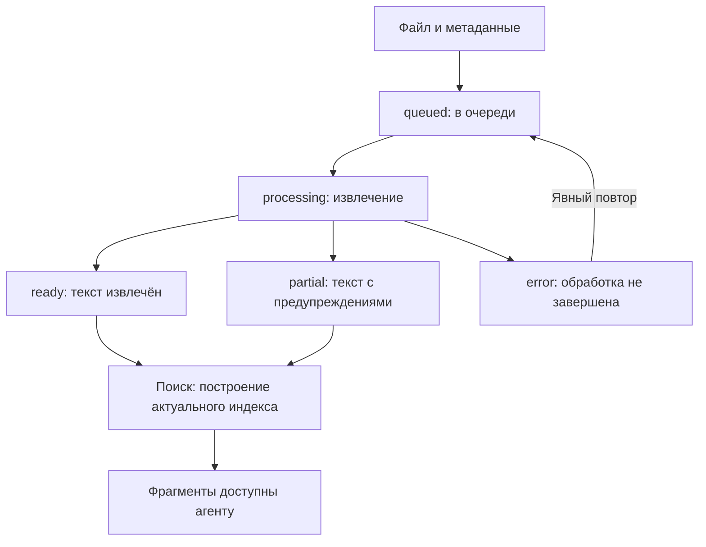

# База знаний: документы, OCR и версии

В третьей версии документы добавляются через тестовый интерфейс. База знаний хранит оригинал, сведения об источнике и извлечённые фрагменты. Это позволяет проверить, откуда взята цитата, и сохранить ссылку на прежний выпуск после загрузки нового.

База предназначена для локального стенда с одним процессом приложения. Отдельный ключ LLM для загрузки документа и распознавания текста не требуется. Для первого построения поискового индекса может потребоваться загрузка файлов embedding-модели.

## Добавление документа

1. Открыть раздел базы знаний и выбрать файл.
2. Указать понятное название. При наличии сведений добавить издателя, дату публикации и ссылку на первоисточник. Дата загрузки не подменяет дату публикации.
3. Отправить файл. Сервер сразу возвращает документ со статусом `queued`; извлечение выполняется последовательно в фоновом потоке.
4. Дождаться `ready` или `partial`, прочитать предупреждения и открыть извлечённые фрагменты. Для OCR особенно важно сверить числа и единицы с оригиналом.
5. При необходимости выбрать документы для следующего вопроса. Поле `document_ids` ограничивает поиск этими документами; пустой выбор означает всю доступную базу. Отдельный переключатель `report_only` запрещает веб-поиск.

Выбор документов сам по себе не отключает интернет. Для ответа только по выбранным файлам нужны и выбор документов, и режим «Только база знаний». Ограничения передаются приложением отдельно от аргументов, которыми управляет модель.

## Какие файлы обрабатываются

| Формат | Что извлекается | Как найти исходное место |
|---|---|---|
| PDF с текстовым слоем | Текст страницы; при наличии растровых изображений дополнительно предпринимается OCR | Физическая страница PDF, начиная с 1 |
| Сканированный PDF | Текст после локального OCR | Физическая страница; распознана страница целиком |
| PNG, JPEG | Текст изображения через OCR | Исходное изображение, его размеры; номер страницы не придумывается |
| DOCX | Абзацы, обычные таблицы, текст колонтитулов; OCR встроенных изображений | Номер абзаца или таблицы, строки таблицы; для изображения — часть файла Office |
| XLSX | Значения листов, строки таблиц, метаданные формул и форматов; OCR встроенных изображений | Название листа и диапазон ячеек |
| CSV | Табличные записи; UTF-8 либо UTF-16 с BOM | Диапазон записей CSV, который может отличаться от физических строк файла |

DOCX не имеет устойчивой пагинации без отдельного движка вёрстки: здесь указываются абзацы и таблицы. Встроенные изображения Office пока не привязаны к точному абзацу или ячейке: сохраняется путь к части документа. OCR относится ко всему изображению, а не к координатам каждого слова.

Для таблиц первая непустая строка принимается за предполагаемый заголовок; это явно отмечено `table_header_inferred`. Строки объединяются в группы с сохранением заголовка и исходных номеров. Такое представление помогает поиску, но не гарантирует правильную интерпретацию многоуровневой таблицы.

Формулы Excel не вычисляются. Если файл содержит сохранённый результат формулы, используется он. Если результата нет, сохраняется предупреждение; вместо выдуманного числа показывается отметка об отсутствующем значении. Макросы и встроенные исполняемые объекты не поддерживаются. Старые `.doc` и `.xls` нужно предварительно сохранить как DOCX/XLSX.

## OCR и его ограничения

Используется локальный Tesseract с языками `rus` и `eng`. PDF сначала разбирается через `pypdf`; страницы для OCR растеризуются через `pypdfium2`. DOCX и XLSX читаются специализированными библиотеками. Текст документов не отправляется в облачную модель для распознавания.

Docling рассматривался как возможный универсальный конвертер, но в текущем коде не используется. Выбран небольшой набор отдельных парсеров: их форматы, ограничения и локаторы проще явно проверить. Сложная реконструкция структуры сканированных таблиц при этом остаётся ограничением.

Если OCR добавил текст, документ получает предупреждение о возможных ошибках в числах и таблицах, поэтому его состояние обычно `partial`. Это не означает, что всё распознавание неудачно: извлечённый текст доступен для поиска, но требует проверки. Если OCR недоступен, а в документе есть читаемый текстовый слой, этот слой сохраняется с предупреждением. Если текста не извлечено совсем, результат — `error`.

| Ограничение | Текущее значение |
|---|---:|
| Размер загружаемого файла | До 100 МиБ включительно (104 857 600 байт) |
| Страниц PDF | 100 |
| Пикселей изображения | 20 миллионов |
| Время одного вызова OCR | 45 секунд |
| Строк таблицы или листа | 20 000 |
| Столбцов | 1 000 |
| Ячеек | 200 000; для XLSX — по всей книге |
| Объём извлечённого текста | 4 миллиона символов |
| Распакованный DOCX/XLSX | 100 МиБ и до 2 000 частей |

Также проверяются структура архива Office, слишком высокая степень сжатия, повторяющиеся имена частей, DTD/внешние XML-сущности и зашифрованные документы. Эти проверки ограничивают входные данные, но приложение не является антивирусом или универсальным сервером обработки любых файлов.

## Что означают состояния



`ready` относится к извлечению текста. Оно не означает, что эмбеддинги уже рассчитаны. Для индексации есть отдельное поле `index_status`: `pending`, `indexed` или `unavailable`. Индекс обновляется при следующем поиске; это может увеличить длительность первого запроса после загрузки.

При перезапуске незавершённые `queued`/`processing` переводятся в ошибку с пояснением. Повтор можно запустить вручную. Перезапуск не выдаёт прерванную работу за успешную, а готовые версии повторно не распознаются.

## Версии и архив

У документа есть стабильный `document_id`, а у каждой загруженной версии — отдельный `version_id`. Оригинал сохраняется по SHA-256. Повтор того же содержимого не создаёт ещё одну копию версии; изменение только имени файла не считается новым содержимым.

`current_version_id` обозначает последнюю загруженную версию. `active_version_id` — последнюю успешно извлечённую. Пока новый выпуск обрабатывается или если обработка завершилась ошибкой, агент продолжает искать по прежнему успешному выпуску. После успешной обработки новая версия заменяет его в текущем поиске.

Оригиналы, тексты и метаданные старых готовых версий сохраняются. Поэтому ссылка из прежнего ответа продолжает вести к тому документу, по которому этот ответ был подготовлен. Архивация исключает документ из новых поисков, но не удаляет оригиналы и не ломает прежние ссылки. Повторная обработка разрешена для ошибочной версии; готовые цитаты не переписываются.

Каталог находится в `data/knowledge/catalog.sqlite3`, оригиналы — в `data/knowledge/originals`, извлечённые блоки — в `data/knowledge/blocks`. При изменении `DATA_DIR` используется соответствующий каталог. В Docker данные сохраняются через том `/app/data`; для резервной копии нужны и база SQLite, и файлы рядом с ней. Приложение следует остановить перед простым копированием этого каталога.

## Первоначальные отчёты и проверка источника

Исходные EIA и Банк России описаны в `data/reports.json`: там зафиксированы название, дата, URL и контрольная сумма. При первом открытии каталога доступные локальные оригиналы регистрируются как встроенные документы. Их архивирование и дальнейшие версии подчиняются тем же правилам, что и пользовательские загрузки.

Для двух заранее зарегистрированных ссылок предусмотрена отдельная **проверка изменения файла по прежнему URL**. Она сравнивает полученный PDF с сохранённой контрольной суммой. Если содержимое изменилось, файл проходит обычную очередь загрузки как новая версия; прежняя версия остаётся активной до успешной обработки. Уже известное старое содержимое не откатывает каталог назад.

Эта операция не ищет новые выпуски на сайте. Например, проверка URL прогноза Банка России за октябрь 2025 года не обнаруживает автоматически прогноз с другим именем файла за следующий месяц. Дата нового содержимого по старому URL не угадывается. Ссылки произвольных загруженных документов остаются метаданными: они не дают серверу права скачивать любой адрес.

Поддержка проверки уточняется через `/api/knowledge/documents/{id}/update-capability`; сама проверка запускается `POST .../check-update`. Разрешены только заранее заданные HTTPS-адреса EIA и Банка России, публичные IP, PDF до 100 МиБ; переходы по редиректам отклоняются. Автоматического расписания, обхода сайтов и поиска свежего выпуска пока нет.

## Поиск и проверяемые ссылки

У каждого извлечённого блока сохраняются `block_id`, `text`, `method` (`native`/`ocr`), `page` при наличии и `locator`. При разбиении для RAG добавляются идентификатор чанка и границы фрагмента. Ответ связывает утверждение с реально полученным фрагментом, версией и адресом оригинала.

Для PDF можно открыть нужную физическую страницу. Для DOCX/XLSX/CSV интерфейс показывает доступный локатор и текст блока. Цитата является фрагментом **извлечённого представления**: при OCR это распознанный текст, при таблице — сериализованные значения. Наличие точной ссылки не отменяет необходимость проверить качество извлечения.

Актуальный поиск обслуживает `src/rag/managed.py`: встроенные и загруженные документы ранжируются вместе одной embedding-моделью. Архив и успешная новая версия меняют ревизию корпуса. Перед выдачей результатов проверяется, что ревизия не изменилась во время построения индекса или поиска.

Исторический retrieval-eval использует прежний фиксированный корпус из двух PDF. Пользовательские загрузки не меняют его разметку и опубликованные метрики. Качество поиска по новым сканам и таблицам нужно оценивать отдельным набором вопросов с эталонными документами, версиями и фрагментами. Подробнее: [архитектура v3](V3_Architecture.md) и [методика eval](Evaluation.md).

## Проверки без облачных ключей

```bash
uv run pytest tests/test_knowledge_store.py tests/test_knowledge_api.py tests/test_extractors.py tests/test_managed_rag.py
```

Тесты проверяют сохранение версий, ограничения загрузки, обработку ошибок, архив, чтение файлов, локаторы и попадание новых данных в поиск. В тестах парсинга используются реальные небольшие PDF/DOCX/XLSX/CSV. Контракт OCR проверяется с подставленным распознавателем; отдельные тесты запускают настоящий Tesseract на подготовленном изображении и сканированном PDF, если он установлен.

Это техническая проверка обработки и передачи данных. Она не доказывает качество OCR на произвольном отчёте и не заменяет живой eval агента с GigaChat.


Повтор обработки в текущем UI доступен для ошибочной версии. Успешное или частично успешное извлечение того же файла не перезаписывается: повторная загрузка определяется по SHA-256. Для нового OCR после изменения языкового пакета пока нужно архивировать старую запись и загрузить файл как новый документ; старые ссылки сохраняются. Отдельные версии повторной обработки без смены документа — следующая доработка.
