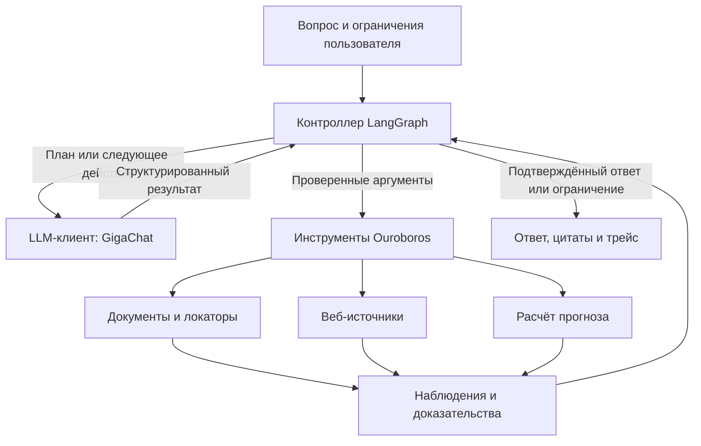

# Третья версия: архитектура и границы реализации

Третья версия продолжает агентский цикл второй: модель выбирает действия с учётом найденных сведений, а приложение проверяет аргументы, границы поиска и основания ответа. Основные доработки относятся к источникам и эксплуатации: облачный GigaChat, пополняемая база знаний, OCR, версии документов, чтение веб-страниц, instruction skills и сохраняемые исследовательские заметки.

Режим этой версии — `AGENT_MODE=loop`. Исторический `workflow` оставлен для сравнения прежней фиксированной последовательности; новые возможности интерфейса и весь сценарий v3 следует проверять в режиме `loop`.

Специализация определяется целью вопроса. Агент анализирует нефтегазовый рынок, производство, инфраструктуру, свойства сырья, цены и экономику отрасли. Личные карьерные вопросы, зарплата профессии и поиск вакансий находятся вне этого мандата, даже если содержат слова «нефтегазовый аналитик». Влияние фонда оплаты труда на себестоимость добычи — профильный вопрос. Границу выбирает модель в `Plan.intent`; `outside` завершает запрос без поиска. Это смысловая классификация по инструкции, её качество проверяется отдельно от исполнения маршрута.

## Один контроллер агентского цикла

LangGraph остаётся единственным контроллером. Внутри работают этапы `plan`, `decide`, `act`, `answer`, `finish`. Новый набор источников сразу передаётся подготовке ответа. Если ответа недостаточно и есть бюджет, модель получает наблюдения и выбирает следующий шаг. Неизменённые повторные действия, отсутствие новых данных и исчерпание времени останавливают исследование.

Модель не может расширить выбор документов, заданный пользователем, или разрешить веб при включённом `report_only`. В общем исследовании поиск по документам и веб-поиск доступны с первого шага: источник выбирается по вопросу, его актуальности и уже найденным доказательствам. Для вопроса по конкретному отчёту естественен RAG; для последнего события — проверка свежих первоисточников. Это ориентиры модели, а не последовательность, зашитая под отдельные формулировки. Чистый численный прогноз может сразу вызвать расчёт.

Приоритет относится к качеству доказательства: релевантности, авторитетности, дате и прямому подтверждению факта. Он не означает, что любой старый PDF сильнее новой официальной публикации. В режиме «только база знаний» веб запрещён, а непроверенная актуальность должна быть обозначена в ответе.

В интерфейсе показываются план, инструменты, источники, причины отклонения действий, длительности и причина остановки. Это наблюдаемые действия системы и данные, на которых построен ответ; они не являются записью скрытых внутренних рассуждений модели.

### Как исполняется запрос с несколькими частями

Если в одном вопросе нужны свойства нефти и последняя котировка, план выделяет две задачи. После выбора Brent или WTI агент запрашивает дневное наблюдение EIA/FRED с датой. Для сравнения свойств модель отдельно выбирает документ или публикацию. При проверке цитат учитывается период именно этого сравнения. Если сервис котировок недоступен, подтверждённое сравнение можно вернуть со статусом `partial`.

Когда модель выбирает поиск в отчётах и оставляет поле запроса пустым, агент может использовать поисковую фразу из плана для первого поиска по существу вопроса. Трейс показывает переданную фразу и её происхождение. Если сам вопрос допускает несколько существенно разных ответов, например «рейтинг» без критерия, модель может предложить варианты и запросить уточнение до обращения к источникам.

## Кто за что отвечает

| Компонент | Ответственность |
|---|---|
| `src/api.py`, `src/static/` | Тестовый интерфейс, вопросы, пользовательские ограничения, доступность возможностей |
| `src/agent.py`, `src/progress.py`, `src/budget.py` | Цикл, список допустимых действий, защита от повторов и бюджеты |
| `src/models/schemas.py`, `src/planning.py` | Схемы и валидация плана, действия, параметров прогноза, ответа |
| `src/integrations/llm.py`, `gigachat.py` | Единый интерфейс генерации, GigaChat OAuth/HTTPS, проверка JSON |
| `src/tools.py` | Аргументы и исполнение прикладных инструментов через Ouroboros |
| `src/knowledge/` | Каталог, версии, локальное извлечение/OCR, очередь, API документов и проверка зарегистрированных источников |
| `src/rag/managed.py` | Текущий изменяемый корпус, ограничения по документам, построение и проверка ревизии индекса |
| `src/rag/index.py`, `embedders.json` | Encoder, FAISS, ранжирование и прежний фиксированный корпус eval |
| `src/evidence.py` | Передача фрагментов, адреса доказательств, проверка ссылок, чисел, смысла и актуальности утверждений |
| `src/clock.py` | Одна текущая дата и время на весь запрос, часовой пояс и контекст всех генераций |
| `src/integrations/web.py`, `web_cache.py` | Tavily Search/Extract, даты и источники, ограниченный кэш |
| `src/integrations/agent_skills.py`, `agent_skills/` | Допуск, загрузка и выбор instruction skills Ouroboros |
| `src/integrations/research_notes.py` | Явно сохранённые заметки через версионное хранилище Ouroboros |
| `src/integrations/telemetry.py`, `src/logging.py` | Локальные трейсы, Langfuse, структурированные эксплуатационные события |
| `eval/`, `tests/` | Измерения на размеченных вопросах и проверки контрактов приложения |

## GigaChat и structured output

Для новой конфигурации в `.env.example` выбран облачный GigaChat. При этом клиент приложения сохраняет общий метод `generate`: контроллер не должен знать особенности авторизации каждого провайдера.

Адаптер GigaChat получает и обновляет access token, выполняет запросы с проверкой TLS и передаёт JSON Schema в нативном формате GigaChat. Затем результат дополнительно проверяется Pydantic. План, следующее действие и ответ с цитатами имеют отдельные схемы. Ошибки авторизации, лимитов, формата или незавершённой генерации не превращаются в успешный ответ.

Для наблюдавшегося сбоя `stop` с пустой строкой добавлена одна резервная попытка той же моделью: JSON запрашивается текстом со схемой в системной инструкции и обязательно проверяется исходной Pydantic-моделью. В трейсах этот режим обозначен `validated_json`, а не нативным строгим выводом. Попытки делят исходный бюджет времени; отказ модели не запускает повтор. Это восстановление генерации, а не подстановка ответа или принудительный выбор веб-поиска. [Диагностика и ограничения](GigaChat.md#пустой-ответ-при-успешной-авторизации).

`src/integrations/structured_output.py` отделяет описание схемы от инструкции сформировать объект данных. Одна и та же схема не дублируется в резервном сообщении. Возврат самой схемы вместо результата распознаётся как `schema_echo` и отклоняется. Ошибки Pydantic записываются в безопасной форме с путём поля и типом нарушения, чтобы отличать ошибки структуры от недоступности API.

Действие модели передаётся как структурированный JSON; отдельный протокол нативных `tool_calls` здесь не используется. Structured output ограничивает форму данных, но не доказывает истинность утверждений. Для этого нужны найденные источники, программные проверки и eval.

OpenAI-совместимый провайдер сохранён как альтернативная конфигурация для сравнения и прежних локальных запусков. Настройка GigaChat и проверка доступа описаны в [GigaChat.md](GigaChat.md). Пока не выполнен запрос с ключом конкретного аккаунта, доступность выбранной модели и качество её ответов не считаются проверенными.

## Текущая дата и область времени

В начале запроса фиксируется одно время с часовым поясом `APP_TIMEZONE` (по умолчанию `Europe/Moscow`). `today`, `current_year`, `current_time` и `timezone` передаются при планировании, выборе инструмента, подготовке ответа и проверке цитат. Служебная дата добавляется LLM-клиентом и не подменяется текстом источника или вопроса. Это позволяет воспроизвести, что значили «сегодня», «сейчас» и «последний» в конкретном трейсе; это не обещание, что сама модель всегда верно рассудит о времени.

Дата запроса, дата публикации, дата события, период статистики и момент скачивания — разные поля. Запрос «последняя встреча» требует проверки на дату запроса; находка события в отчёте за прошлый год не устанавливает, что позднее встреч не было. Явный исторический период пользователя сохраняется. В UI и JSON ответа доступен `diagnostics.time_context`.

## Что дополнительно используется из Ouroboros

| Механизм | Как применяется | Что из этого не следует |
|---|---|---|
| `ToolRegistry` | Вызовы `report_search`, `read_report`, `web_search`, `read_web`, `price_forecast` | Ouroboros не запускает второй независимый агентский цикл |
| Instruction skills | План выбирает `report_analysis`, `web_research` или `price_forecast`; проверенные инструкции добавляются в контекст следующих этапов | Это инструкции по работе, а не готовые ответы или исполняемые плагины |
| Каталог и допуск skills | Проверяются формат манифеста, версия, содержимое, состояние включения и соответствие утверждённому набору | Не заявляется автоматическое обучение или экспертная проверка skill моделью |
| Версионные knowledge notes | Пользователь явно сохраняет результат, историю источников и `trace_id`; изменения проверяют ожидаемую ревизию | Заметка не становится проверенным отраслевым источником |

Поставляемые skills содержат только инструкции из репозитория. Их хеши закреплены в `agent_skills/approved.json`. Используются реальные загрузчик, каталог, состояние включения и запись происхождения установки Ouroboros. Если файл изменён вне утверждённой версии или отключён, он не должен незаметно попасть в системный контекст. В трейс записываются название, версия и хеш выбранного skill.

Заметки сохраняются в `data/ouroboros` через `ouroboros.knowledge`. Они добавляются к следующему запросу только после явного выбора пользователем. Содержимое помечено как непроверенный контекст; прежние `R1`/`W1` не считаются действительными доказательствами нового ответа. Для фактических утверждений агент должен снова обратиться к источникам. Автоматического извлечения памяти из каждого разговора и самостоятельного переписывания промптов нет.

## Изменяемый RAG

Оригинал загруженного файла сохраняется отдельно от извлечённого представления. Извлечение создаёт блоки с версией, физической страницей PDF либо локатором абзаца, листа, ячеек или изображения. После успешной обработки эти блоки участвуют в поиске. Подробности состояний, OCR и обновлений приведены в [KnowledgeBase.md](KnowledgeBase.md).

Новые блоки делятся на окна по **токенизатору выбранного эмбеддера** с перекрытием. Учитываются служебные токены, модельные префиксы и повторённый заголовок таблицы. Для цитирования сохраняются точный фрагмент извлечённого блока и его символьные границы. Повторённый заголовок может помогать эмбеддингу; он не выдаётся за часть непрерывной исходной цитаты, если её там нет.

По умолчанию используется `minilm-multi` — `paraphrase-multilingual-MiniLM-L12-v2`, локальный ONNX-вариант с окном 128 токенов. Для сравнения доступен `e5-small` — `multilingual-e5-small`, окно 512 токенов и префиксы `query:`/`passage:`. Ревизии и контрольные суммы файлов закреплены в `src/rag/embedders.json`; выбор задаётся `RAG_EMBEDDING`.

Встроенные и пользовательские документы участвуют в одном ранжировании через FAISS. Режим `dense` остаётся базовым; `hybrid` добавляет сравнение с лексическим BM25/RRF. Сам факт существования гибридного режима не доказывает, что он лучше на новом корпусе.

Есть два разных назначения корпуса:

| Корпус | Для чего нужен | Что меняется при загрузке |
|---|---|---|
| Фиксированный `src.rag.index` | Сопоставимые исторические retrieval-замеры по двум исходным PDF | Ничего: разметка и прежние chunk ID сохраняются |
| Текущий `src.rag.managed` | Работа приложения с выбранными документами, новыми версиями и архивом | Меняются активные блоки, ревизия и индекс текущего корпуса |

Старые базовые чанки сохраняют прежнее разбиение для сопоставимости eval; новые загрузки используют токенные окна. Поэтому результаты старого benchmark нельзя переносить на сканы, таблицы и динамический корпус без новой разметки.

## Веб-поиск и чтение источника

`web_search` обнаруживает публикации через Tavily Search; `read_web` читает уже найденную доверенную страницу через Tavily Extract. Модель может выбрать общий или новостной поиск, период и глубину в пределах схемы. Контроллер передаёт результаты обратно как наблюдения, после чего модель решает, нужны ли дополнительные сведения.

`days` и `start_date/end_date` задают альтернативные способы ограничения периода. Если модель передала оба, до исполнения инструмента выполняется одна уточняющая генерация по схеме `WebTimeFilterChoice`: модель выбирает `relative`, `dates` или `unbounded`. Код сохраняет выбранные ею параметры, не меняя инструмент и поисковый запрос. Для вопроса о последнем событии без заданного периода промпт рекомендует поиск без произвольного окна в 30 дней. Явный период пользователя должен сохраняться; смысловой выбор модели требует живой проверки.

Исходный и исправленный фильтры записываются в `argument_repair` решения и диагностического шага. Дополнительная генерация видна в трейсе `llm.web_time_filter` и делит общий бюджет времени. При её сбое некорректный вызов не отправляется. Независимо от модели инструмент проверяет параметры до HTTP-запроса: ошибка аргументов получает `status=error`, а действительно выполненный поиск без результатов — `status=ok` и пустой список.

Различаются поисковый фрагмент, извлечённый текст страницы и выбранные Tavily фрагменты по запросу. Сохраняются URL, время получения, известная дата публикации, способ получения и признак ограничения текста. Время скачивания не подменяет дату публикации. Ответ без установленной даты нельзя автоматически считать подтверждением свежего события.

Результаты ограничены разрешёнными доменами и HTTP(S)-политикой клиента. Это снижает количество неподходящих источников, но не гарантирует правильность каждого текста. Кэш уменьшает повторные одинаковые запросы и сохраняет происхождение данных. Без Tavily остаются ограниченные RSS EIA/Банка России и дневные наблюдения Brent/WTI через EIA/FRED; это не полноценная замена общего веб-поиска.

## Проверяемость ответа и оценка качества

Ответ строится из утверждений с адресами реально полученных блоков. Код подставляет цитаты из этих блоков и сохраняет страницу, версию или табличный локатор. Для веба показываются URL и доступный фрагмент. Такие ссылки позволяют проверить ответ, но не снимают ошибок OCR, неверной трактовки таблицы или смешения единиц.

После программных проверок ID и чисел по умолчанию выполняется один `citation_review` для текущего кандидата. Проверяющая модель видит вопрос, текущую дату, требования актуальности и точные цитаты. Она должна отсеять подмену содержания публикации библиографией, смешение дат и неподтверждённое утверждение «последнее на сегодня». Один лишь успешный веб-вызов не делает ответ актуальным.

Проверка разделяет поддержку отдельных утверждений (`supported`) и достаточность ответа целиком (`coverage`, `missing_aspects`). Для обзора несколько верных примеров не обязательно закрывают охват; для узкого факта один фрагмент может быть достаточен. Также проверяется запрошенная связь: описание свойств сорта не доказывает торговлю им. Полный ответ требует `coverage=sufficient` и отсутствия пробелов. Эти поля входят в уже существующий вызов review.

Отклонённый кандидат не заменяется старым ответом с прежним `complete=true`. Замечание и конкретные пробелы возвращаются в агентский цикл; модель может изменить поиск, открыть источник или завершить с ограничением. Проверка расходует время и токены в общем бюджете запроса, без бесконечной цепочки проверяющих. `ANSWER_SELF_REVIEW=false` отключает семантическую проверку: текст с утверждениями получает публичный статус `partial` и явную оговорку. Готовый кандидат не вызывает повторные поиски только ради выключенной проверки, но обязательные расчёты и котировки сохраняются. Даже включённая самопроверка остаётся оценкой модели, а не независимым доказательством качества.

Трейс связывает вопрос, этапы графа, обращения к модели, инструментам и источникам через `trace_id`. Для генераций сохраняются провайдер, модель, версия промпта, схема и метаданные skill; для поиска — используемые результаты и идентификаторы. Langfuse подключается отдельно; локальный JSONL работает и без него. Содержимое запросов и ответов включается через `TRACE_CONTENT`, по умолчанию оно отключено.

Качество оценивается по нескольким слоям:

| Слой | Что проверяется |
|---|---|
| Извлечение | Числа и единицы, сохранение строк таблицы, честные локаторы, предупреждения OCR |
| Retrieval | `hit@1`, `hit@5`, `MRR@10`, покрытие необходимых цитат; отдельно для корпуса и эмбеддера |
| Выбор действий | Подходящий источник по задаче, соблюдение пользовательских ограничений, проверка актуальности и отсутствие бесполезных повторов |
| Ответ | Отношение к вопросу, полнота, подтверждённость, корректность интерпретации и формат |
| Эксплуатация | Время, ошибки внешних сервисов, количество решений, стоимость и устойчивость обновления базы |

`hit@5` означает, что среди первых пяти результатов найден хотя бы один размеченный фрагмент; это не процент правильных ответов агента. MRR характеризует место первого релевантного результата. Для вопроса, которому нужны несколько независимых фактов, дополнительно важно покрытие всех нужных цитат. Сходство вектора само по себе не является вероятностью истинности.

Тесты с подставленными ответами LLM/HTTP проверяют контракты, сбои и передачу доказательств. Проверка настоящего Tesseract на подготовленном скане проверяет OCR в ограниченном сценарии. Исторические результаты Qwen относятся к прежней модели и соответствующему состоянию корпуса. Ни один из этих результатов не заменяет новый живой прогон GigaChat и проверку человеком. Методика и команды собраны в [Evaluation.md](Evaluation.md).

## Текущие границы

- Локальный стенд рассчитан на одного оператора и один процесс приложения; нет полноценной многопользовательской авторизации, распределённой очереди и управления правами на документы.
- Поддерживается ограниченный набор форматов и размеров. OCR сканов и сложных таблиц требует сверки; обещания обработать любой PDF или изображение нет.
- Проверка зарегистрированного URL обнаруживает изменение того же файла. Поиск новых выпусков, обход сайтов и расписание обновлений ещё не реализованы.
- Индекс текущего корпуса строится при обращении к поиску. Первая загрузка эмбеддера и первый запрос после изменения базы могут занять дополнительное время.
- Сохранение заметок выполняется пользователем; автоматическая долговременная память и самоизменение агента не включены.
- Допуск skills ограничен поставляемыми инструкциями. Произвольные скачиваемые исполняемые skills не устанавливаются агентом.
- Семантическая правильность остаётся предметом eval. Успешный статус инструмента или корректный JSON не равны правильному отраслевому выводу.

Ветки разработки сохраняют этапы проекта; сведения о текущей версии следует читать вместе с её кодом, конфигурацией, хешем корпуса и результатом конкретного eval-прогона.
